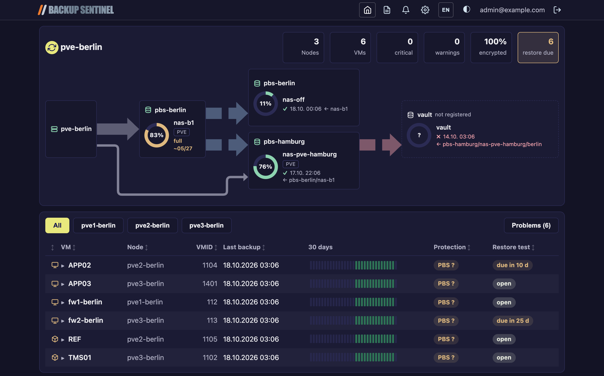
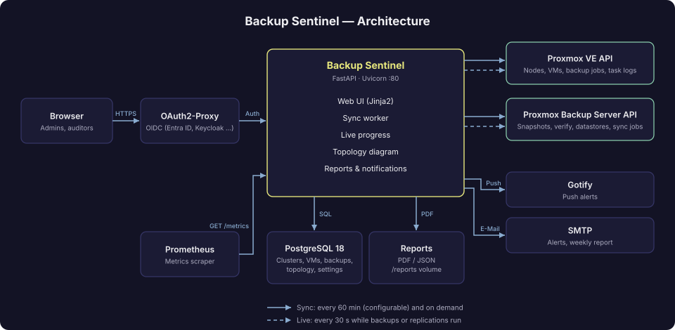

# Backup Sentinel

[](https://github.com/wvogel/backup-sentinel/actions/workflows/ci.yml)
[](https://github.com/wvogel/backup-sentinel/actions/workflows/codeql.yml)
[](https://github.com/wvogel/backup-sentinel/releases)
[](LICENSE)
[](https://www.python.org/)
[](https://fastapi.tiangolo.com/)
[](https://www.postgresql.org/)
[](https://www.docker.com/)
[](https://docs.astral.sh/ruff/)
[](https://github.com/wvogel/backup-sentinel/commits/main)
[](https://github.com/wvogel/backup-sentinel/stargazers)

Compliance-focused monitoring for Proxmox backup infrastructure. Track backup status, encryption, verification, and document restore tests across PVE clusters and PBS instances — aligned with NIST CSF 2.0 and NIS2 requirements.






## Features

- **Overview** — Restore-test KPIs and one row per cluster: PVE and PBS sync state as colored symbols, running backups and replications, tiles for nodes, VMs, critical, warnings, encryption and restore tests due
- **Cluster detail** — Per-VM backup status with 30-day history bars, protection (PBS copies, offsite), backup policy overrides, encryption audit
- **Backup topology** — Diagram of where backups go: PVE → PBS datastores → replicas (pull, push, local sync jobs), with datastore usage, fill-up forecast, per-namespace copy counts and live animation while data moves
- **Live progress** — Running backups (percent, ETA, throughput, "slow" hint) and running PBS replications, refreshed every 30 s without reloading
- **Logs** — Sync logs and restore-test notes open in a dialog with one-click copy
- **Restore test documentation** — Record and track recovery tests (full, partial, file-based) for compliance evidence
- **Reports** — Monthly PDF/JSON reports with per-cluster and per-VM breakdown, archive for audit; weekly HTML email summary
- **Notifications** — Gotify push for failed syncs, critical backups, slow backups, failed verifies, datastores filling up and anomalies (bundled, deduplicated, held back during quiet hours); SMTP email for sync outages over 24 h, the monthly PDF report and the weekly report; history with CSV export at `/notifications`
- **Multi-cluster** — Monitor multiple PVE clusters and PBS instances from one place
- **Monitoring** — `/healthz` and Prometheus metrics at `/metrics`
- **Governance** — NIST CSF 2.0 / NIS2 mapping (Identify, Protect, Detect, Recover), settings audit log
- **Internationalization** — German and English UI with one-click switching
- **Theme** — Light, dark, and auto (system) modes

## Requirements

- Docker & Docker Compose
- A reverse proxy such as [Nginx Proxy Manager](https://github.com/NginxProxyManager/nginx-proxy-manager)
- [OAuth2-Proxy](https://github.com/oauth2-proxy/oauth2-proxy) for authentication (included in `docker-compose.yml`)
- An OIDC-compatible identity provider (Keycloak, Azure Entra ID, Google, etc.)

## Quick Start

```bash
# Clone and configure
git clone https://github.com/wvogel/backup-sentinel.git
cd backup-sentinel
cp .env.example .env
cp oauth2-proxy.env.example oauth2-proxy.env

# Edit .env and oauth2-proxy.env with your values

# docker-compose.yml expects these two networks as external
docker network create shared-npm    2>/dev/null || true
docker network create shared-valkey 2>/dev/null || true

# Then start the stack
docker compose up -d
```

The app will be available behind the OAuth2-Proxy on port 4180.

## Configuration

The most important variables are listed below. See [`.env.example`](.env.example) and the [full table in the Admin Guide](docs/admin-docs-en.md#environment-variables) for all of them.

| Variable | Description | Default |
|----------|-------------|---------|
| `APP_URL` | Public URL of the application | `https://backup-sentinel.example.com` |
| `DB_NAME` | PostgreSQL database name | `backup_reports` |
| `DB_USER` | PostgreSQL user | `backup_reports` |
| `DB_PASSWORD` | PostgreSQL password (also change `BSENTINEL_DATABASE_URL`) | `backup_reports` |
| `BSENTINEL_SECRET_KEY` | Fernet key for encrypting secrets; without it they are stored unencrypted | *(empty)* |
| `BSENTINEL_DEFAULT_TIMEZONE` | Timezone for display | `Europe/Berlin` |
| `BSENTINEL_SYNC_INTERVAL_MINUTES` | Auto-sync interval | `60` |

For OAuth2-Proxy configuration, see [`oauth2-proxy.env.example`](oauth2-proxy.env.example).

## Documentation

- [User Guide (English)](docs/user-docs-en.md) · [Benutzerhandbuch (Deutsch)](docs/user-docs-de.md)
- [Admin Guide (English)](docs/admin-docs-en.md) · [Admin-Handbuch (Deutsch)](docs/admin-docs-de.md)
- [Architecture (English)](docs/architecture-en.svg) · [Architektur (Deutsch)](docs/architecture-de.svg)

## Deployment

### GitLab CI/CD

`.gitlab-ci.yml` has three stages:

| Stage | What it does |
|-------|--------------|
| `lint` | `ruff check` and `ruff format --check` on `app`, `tests`, `scripts` |
| `test` | `pytest` against a `postgres:18` service (`BSENTINEL_DB_TESTS=1`, so the DB tests run too) |
| `deploy` | Only on `main`: sends a `POST` to every CI/CD variable whose name starts with `DEPLOY_WEBHOOK` (e.g. `DEPLOY_WEBHOOK_PROD`) |

There is no SSH step: the webhook endpoint on your server decides what happens, typically running [`deploy.sh`](deploy.sh) (see the [Admin Guide](docs/admin-docs-en.md#updating)). The version is set by hand in `APP_VERSION` in `app/config.py` (`vMAJOR.MINOR.PATCH`).

### GitHub Actions

`.github/workflows/` contains `ci.yml` (lint and tests on push and pull requests to `main`), `codeql.yml` (code scanning) and `release.yml` (creates a GitHub Release with the notes from `CHANGELOG.md` when a `v*.*.*` tag is pushed).

All application secrets (`DB_PASSWORD`, `BSENTINEL_SECRET_KEY`, OAuth2 credentials) are configured in `.env` and `oauth2-proxy.env` directly on the server — they are never stored in CI/CD or the repository.

## Project Structure

```
backup-sentinel/
├── app/                  # FastAPI application
│   ├── i18n/             # Translations (en.json, de.json)
│   ├── services/         # PVE/PBS clients, sync, topology, reports, notifications
│   ├── web/              # Route handlers
│   └── ...
├── templates/            # Jinja2 HTML templates
├── static/               # CSS, JS, favicon
├── scripts/              # Bootstrap shell scripts, local dev harness (dev.sh)
├── docs/                 # Documentation and architecture diagrams
├── docker-compose.yml    # Container orchestration
├── Dockerfile            # Application container
├── .env.example          # Environment variable template
└── oauth2-proxy.env.example  # OAuth2-Proxy configuration template
```

## Development

```bash
python -m venv .venv
source .venv/bin/activate
pip install -r requirements.txt
pip install --no-deps -r requirements-nodeps.txt

# Run locally (requires PostgreSQL)
uvicorn app.main:app --reload --host 0.0.0.0 --port 8000
```

For testing in a real browser there is a Docker harness without the login wall and with sample data: `./scripts/dev.sh` starts Postgres and the app using the `docker-compose.dev.yml` overlay and seeds the database. See [docs/dev-local.md](docs/dev-local.md).

## License

[MIT](LICENSE) — Copyright (c) 2026 Backup Sentinel Contributors
