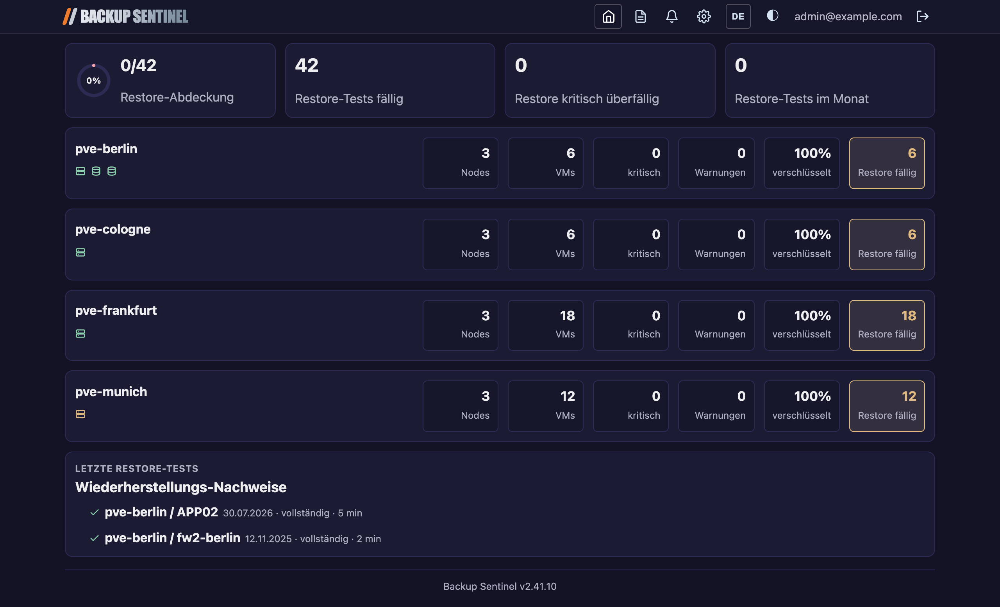
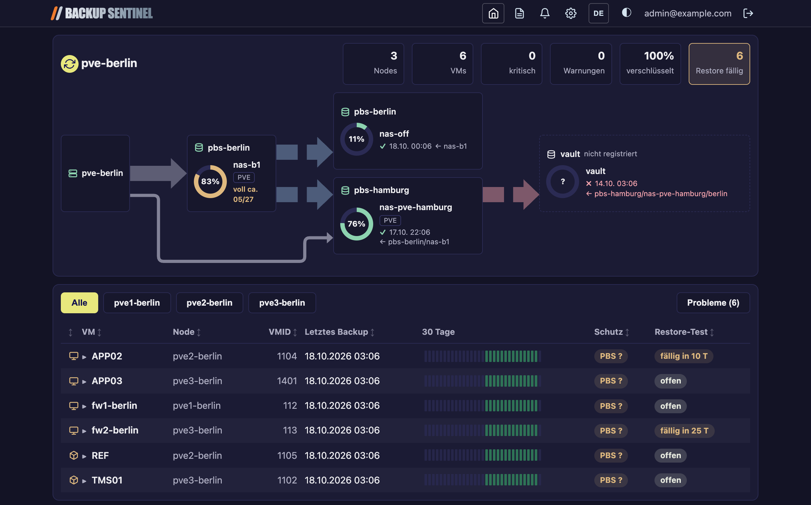

# Backup Sentinel -- Benutzerhandbuch

## Inhaltsverzeichnis

1. [Dashboard](#dashboard)
2. [Cluster-Detailseite](#cluster-detailseite)
3. [Berichte](#berichte)
4. [Benachrichtigungen](#benachrichtigungen)
5. [Einstellungen](#einstellungen)
6. [Design & Sprache](#design--sprache)

---

## Dashboard

Das Dashboard (`/`) bietet eine Gesamt-Übersicht über alle überwachten Proxmox-Cluster.

### KPI-Karten

Oben stehen vier Kennzahlen zu den Restore-Tests:

- **Restore-Abdeckung** -- Ein Ring mit dem Anteil der VMs, die einen dokumentierten Restore-Test haben (z. B. „12/83“). Die Farbe wechselt von Grün (>= 80 %) über Gelb (>= 50 %) zu Rot (< 50 %).
- **Restore-Tests fällig** -- VMs, deren Restore-Test-Intervall abgelaufen ist oder bald abläuft.
- **Restore kritisch überfällig** -- VMs, deren Restore-Test deutlich überfällig ist.
- **Restore-Tests im Monat** -- Im laufenden Kalendermonat dokumentierte Restore-Tests.

### Cluster-Zeilen

Darunter folgt je Cluster eine Zeile, alle gleich hoch:

- **Name** des Clusters, darunter die **Sync-Symbole**: ein Server-Symbol für PVE und ein Datenbank-Symbol je PBS. Ihre Farbe zeigt, wie aktuell die Daten sind: grün = letzter Sync erfolgreich und höchstens zwei Sync-Intervalle her (ein ausgelassener Lauf ist in Ordnung), gelb = länger her oder der letzte Versuch schlug fehl, rot = seit über 24 Stunden kein erfolgreicher Sync bzw. letzter PBS-Sync fehlgeschlagen, grau = PBS noch nie synchronisiert. Ein gemeinsamer Tooltip nennt für PVE den Zustand, den letzten erfolgreichen Sync und ggf. „Fehlerzustand seit“, für jeden PBS den letzten Sync und sein Ergebnis.
- Neben dem Namen, was **gerade läuft**: „1 Backup“, „2 Backups“, „1 Replikation“ mit drehendem Symbol (Tooltip: die VMs bzw. Quelle → Ziel). Ist wenig Platz, rutschen sie neben die Symbole; die Zeile wird dadurch nicht höher.
- Rechts die **Kacheln**: Nodes, VMs, kritisch, Warnungen, verschlüsselt, Restore fällig. Kacheln mit Handlungsbedarf sind farbig umrandet. Hat der Cluster ein Quorum-Device (QDevice), steht in der Nodes-Kachel ein kleines „+Q“ neben der Zahl (Tooltip: Zustand und QNetd-Host); ist es nicht verbunden, wird die Kachel gelb.

Klicken Sie auf eine Cluster-Zeile, um zur Detailseite zu navigieren.

---

## Cluster-Detailseite

Die Cluster-Detailseite (`/clusters/<slug>`) bietet einen detaillierten Einblick in einen einzelnen Proxmox-Cluster.

### Sync-Status

Im oberen Bereich zeigt die Hero-Sektion:

- **Sync-Button** -- Löst eine sofortige Neusynchronisation des Clusters aus.
- **Sync-Status** -- Im Schaubild (siehe *Backup-Ziele und Replikation*) ist das Server-Symbol des Clusters (PVE) und das Datenbank-Symbol jedes PBS farbig wie auf der Übersicht; der Tooltip nennt Zustand und letzten Sync. Ohne Schaubild stehen die Symbole in der Kopfzeile.
- **Sync-Log** -- Ein Klick auf ein Sync-Symbol öffnet das Log in einem Fenster über der Seite, ans Ende gescrollt. Das Kopier-Symbol oben rechts kopiert das ganze Log (ein Haken bestätigt es); ×, Esc oder ein Klick daneben schließen es. Läuft gerade ein Sync, erscheint dort das Live-Log. Dasselbe Fenster zeigt auch die Notiz eines Restore-Tests.

### Statistik-Kacheln

Interaktive Statistik-Kacheln zeigen Node-Anzahl, VM-Anzahl, Kritisch/Warnung-Zähler, Verschlüsselungsgrad und Restore-fällig-Anzahl. Klicken Sie auf eine Kachel, um die VM-Tabelle darunter auf passende Zeilen zu filtern.

### Warnung bei unverschlüsselten Backups

Falls VMs unverschlüsselte Backups haben, listet ein aufklappbarer Warnbereich die betroffenen VMs mit dem Datum des letzten unverschlüsselten Backups auf.

### VM-Tabelle

Die Haupttabelle listet jede VM im Cluster mit sortierbaren Spalten:

| Spalte         | Beschreibung                                                |
|----------------|-------------------------------------------------------------|
| 🖥 / 📦         | Gast-Symbol: Monitor = VM, Kiste = Container. Die Farbe ist der Status: grün = alles in Ordnung und mindestens 2 Backup-Standorte, blau = in Ordnung, aber nur ein Backup-Standort (Info, kein Problem), gelb = Warnung, rot = kritisch (schlechtester Wert aus Backup-Alter und Verify); ausgegraut = VM gelöscht. Der Tooltip nennt die Gründe |
| HA             | Der Gast wird von PVE-HA verwaltet. Mit Rahmen, wenn er nur auf bestimmten Nodes laufen darf (oder auf bestimmten nie). Der Tooltip nennt HA-Zustand und Nodes, z. B. „Darf nur laufen auf: pve1 (2), pve2“ (Zahl = Priorität); Quelle sind die Node-Affinity-Regeln (PVE 9) bzw. die HA-Gruppe (ältere PVE) |
| TPL            | Der Gast ist eine Vorlage (Template) in PVE: läuft nicht, dient zum Klonen. Dezent ausgegraut |
| VM             | Gastname; ein kleines **w** bzw. **–** zeigt wöchentliche Backups bzw. „kein Backup vorgesehen“ |
| Node           | Der Proxmox-Node, auf dem die VM läuft                     |
| VMID           | Proxmox-VM-ID                                               |
| Letztes Backup | Zeitstempel des jüngsten Backups; laufende Backups werden in der Zeile als Fortschritt angezeigt |
| 30 Tage        | Ein Balken pro Tag (grün = OK, orange = inzwischen gelöscht, rot = fehlgeschlagen, grau = kein Backup). Bei schmalem Fenster zeigt die Leiste weniger Tage statt dünnerer Balken; die Überschrift nennt dann die Anzahl |
| Schutz         | Quelle (PBS/lokal), Anzahl Server mit aktuellem Backup (7 Tage, 9 bei wöchentlichem Sync-Job; **×2**) und Verify-Status (**✓**/**?**/**✗**). Nur umrandet, wenn alles passt; farbig bei Warnung/Fehler |
| Restore-Test   | „fällig in N T“, **offen** (noch nie getestet), „N T überfällig“ oder „–“ (kein Test vorgesehen). Der Tooltip zeigt den letzten Test |

Die Zeilen sind abwechselnd hinterlegt. **Ein Klick auf eine Zeile** (erkennbar am ▶ vor dem VM-Namen) öffnet darunter die Details: die Einstellungen der VM und den Verlauf der letzten 30 Tage mit einem Balken pro Tag (Größe, Dauer, Durchsatz, wiederverwendete Daten). Zugeklappt wird mit **Einklappen**, einem Klick auf eine freie Stelle der Details oder erneut auf die Zeile.

**Node-Filterleiste** -- Buttons oberhalb der Tabelle filtern VMs nach Node. **Probleme (n)** am Ende zeigt nur VMs mit einem Problem: Backup kritisch oder Warnung, Restore-Test kritisch überfällig, oder Verify fehlgeschlagen bzw. seit über 30 Tagen nicht verifiziert. Eine nie getestete VM („offen“) zählt allein nicht; n ist die Zahl dieser VMs.

**Sortierung** -- Klicken Sie auf einen Spaltenkopf, um auf-/absteigend zu sortieren.

**Backup-Frequenz** -- In den Details einer VM (Klick auf die Zeile) lässt sich die automatisch erkannte Frequenz überschreiben (täglich / wöchentlich / nie / auto).

**Restore-Test-Fälligkeit** -- Die Restore-Test-Spalte warnt rechtzeitig vor Ablauf des Test-Intervalls. Der Vorlauf richtet sich nach dem Intervall: bei **jährlichen** Intervallen erscheint die **Warnung 1 Monat** vorher, bei **quartalsweisen** (oder kürzeren) Intervallen **2 Wochen** vorher. Nach Ablauf des Intervalls wird der Eintrag rot („N T überfällig“). Der Tooltip zeigt den letzten Test und das Intervall.

**Restore-Intervall** -- In den Details einer VM legt ein Auswahlfeld fest, wie oft eine VM getestet werden muss: **90 T**, **180 T** (Standard), **365 T** oder **kein** Test nötig. Bei wöchentlichen Backups gelten mindestens 365 Tage. Eine VM, die noch nie getestet wurde, steht auf **offen**: Sie zählt als fällig, aber nicht als kritisch überfällig. Im Formular *Wiederherstellung dokumentieren* lassen sich mehrere VMs auf einmal auswählen (Strg/⌘), z. B. für eine komplette Restore-Übung.

**Zweitkopie und Verify** -- Die Pill in der Spalte Schutz zeigt, auf wie vielen Servern die Backups der letzten 7 Tage liegen (z. B. **×2**), und den Verify-Status des PBS: **✓** verifiziert, **?** seit über 30 Tagen nicht verifiziert, **✗** Verify fehlgeschlagen. Grün = mindestens 2 Server und verifiziert; blau = ein Server und verifiziert (in Ordnung, nur ohne Zweitkopie); gelb = nicht verifiziert; rot = Verify fehlgeschlagen (dazu kommt eine Benachrichtigung). Ein PBS zählt als ein Server, auch wenn er in PVE unter einem anderen Storage-Namen, per IP oder ohne Fingerabdruck (z. B. mit ACME-Zertifikat) eingetragen ist: Backup Sentinel ordnet den PVE-Storage der registrierten PBS-Verbindung zu (Fingerabdruck, Hostname, Kurzname oder aufgelöste IP) und zeigt im Tooltip die Servernamen. Als aktuell zählt eine Kopie, wenn ihr letztes Backup höchstens 7 Tage alt ist; wird der Server von einem wöchentlichen Sync-Job beliefert, 9 Tage (eine Woche zwischen den Kopien plus Backup-Tag und Puffer). Der Tooltip nennt je Server die letzte Kopie und markiert zu alte mit „zählt nicht“. Ziel-Namespaces von Sync-Jobs, die Backups dieses Clusters kopieren, liest Backup Sentinel automatisch mit.

**Backup-Ziele und Replikation** -- Rechts im Cluster-Kopf zeigt ein Schaubild, wohin die Backups gehen: vom Cluster (PVE) zu den Datastores, in die PVE direkt sichert (laut PBS-Storages in der PVE-Konfiguration), und von dort über die Sync-Jobs der PBS weiter zu ihren Kopien (Pull, Push und lokale Syncs; gestrichelte Linie, blau = letzter Lauf OK, gelb = mit Warnungen, rot = fehlgeschlagen, grau = noch nie gelaufen). Direkte Verbindungen sind breite Leitungen mit gefüllter Pfeilspitze in Datenrichtung, Replikationen bestehen aus Blöcken; Linien, die außen herum laufen, sind dünn. In Ruhe sind die Leitungen gedämpft und stehen still. Läuft ein Backup oder ein Sync, leuchtet seine Leitung auf, ein weicher Lichtstreifen läuft wie in einer laufenden VM-Zeile hindurch und die Blöcke einer Replikation bewegen sich (bei Backups die Linie zu den Storages, in die die Backup-Jobs der VM schreiben). Alle Animationen laufen im Takt der Uhr: Das Nachladen alle 30 Sekunden oder ein Neuladen der Seite setzt sie nicht zurück, sie laufen nahtlos weiter. „PVE · n VMs“ zählt nur direkte Backups laut den Backup-Jobs von PVE (Auswahl nach VMIDs, alle mit Ausschlüssen, Pool, Node); Kopien, die ein Sync-Job in denselben Datastore holt, zählen nicht. Ein in PVE eingetragener Storage ohne Backup-Job bekommt keine PVE-Linie. Daneben zeigt „Sync · n VMs“ bei einem Datastore, in den Sync-Jobs kopieren, wie viele Gäste dieses Clusters dort eine aktuelle Kopie liegen haben, ohne die direkt dorthin gesicherten (Stand des letzten Syncs). Aktuell heißt wie in der Schutz-Spalte: höchstens 7 Tage alt, bei wöchentlichen Sync-Jobs 9. Gäste, von denen dort nur ältere Kopien liegen – der Sync bringt sie nicht mehr –, stehen gelb als „n veraltet“ dahinter; der Tooltip nennt sie mit dem Datum ihrer letzten Kopie. Ein laufender Sync zeigt in seiner eigenen Zeile unter dem Ziel-Datastore einen kleinen drehenden Ring mit seinem Fortschritt (aus dem Task-Log des PBS, alle 30 Sekunden nachgeladen); laufen mehrere Syncs in denselben Datastore, steht jeder mit seinem Ring untereinander. „Läuft seit“ steht im Tooltip des Rings. Ist der Sync fertig, zeigt die Zeile wieder Haken und „gerade fertig“. Zwischen zwei Kästen gibt es immer genau eine waagerechte Verbindung, auch wenn mehrere Datastores oder Jobs dazwischen liegen; sie zeigt den auffälligsten Zustand (läuft vor fehlgeschlagen, Warnung, OK). Ein PBS kann dabei für einen Datastore Primärziel und für einen anderen Kopie sein; sichern sich zwei PBS gegenseitig, gibt es Pfeile in beide Richtungen. Kopien werden je Namespace verfolgt, sodass ein Datastore mit den Kopien mehrerer Cluster nur die eigenen zeigt. Der Sync-Status steckt im Symbol vor dem Cluster-Namen (PVE) und vor dem Namen jedes PBS (Farben wie auf der Übersicht); der Tooltip zeigt Zustand und Zeit, ein Klick öffnet das Sync-Log. Das Schaubild wird bei jedem Sync vorberechnet, damit die Seite schnell lädt. Unter jeder Kopie stehen Quelle (mit Namespace, falls gesetzt) und letzter Lauf, im Tooltip Zeitplan, Namespaces und nächster Lauf. PBS, die nicht in Backup Sentinel registriert sind, erscheinen gestrichelt mit dem Namen aus der Remote-Konfiguration und ohne Belegung.

**PBS-Speicherplatz** -- Jeder Datastore im Schaubild ist ein Ring mit seiner Belegung und, falls er voll läuft, der Prognose des PBS („voll ca. 04/27“). Gelb ab 80 % oder voll in ≤ 60 Tagen, rot ab 90 % oder voll in ≤ 14 Tagen (dann auch als Benachrichtigung). Läuft ein Datastore laut Prognose in den nächsten 30 Tagen voll, steht ein Warndreieck neben dem Namen (gelb, rot ab ≤ 14 Tagen; Tooltip: Tage und Datum). Eine Prognose in der Vergangenheit (sinkende Belegung) wird ignoriert.

**Laufende Backups** -- Über der Tabelle erscheint für jedes gerade laufende Backup eine Kachel mit Fortschrittsring, geschriebener Datenmenge, voraussichtlichem Ende und Durchsatz (↓ Lesen, ↑ Schreiben, ⇅ wenn beides gleich ist); der ganze Ring dreht sich langsam und pulsiert, sodass auch ein Bogen von wenigen Prozent sichtbar wandert. Läuft ein Backup deutlich länger als üblich, steht „langsam, sonst 40 min“ darunter. Ein Klick springt zur VM. In der Tabelle ist die Zeile bis zum aktuellen Prozentwert eingefärbt und links blau markiert; der Hinweis zeigt Start, ETA und Datenmenge. Die Anzeige aktualisiert sich alle 30 Sekunden, ohne die Seite neu zu laden; die Seite selbst wartet nie auf PVE, sondern holt den Fortschritt direkt nach dem Laden nach. Auf der Übersicht zeigt jede Cluster-Zeile, wie viele Backups laufen, und „1 Replikation“, solange ein Sync-Job eines PBS in die Datastores des Clusters kopiert (Tooltip: Quelle → Ziel).

**Gelöschte VMs** -- VMs, die im Proxmox-Cluster nicht mehr existieren, erscheinen ausgegraut mit dem Badge **gelöscht** (Tooltip: seit wann), solange noch Backups von ihnen vorhanden sind. Sie lösen keine Backup- oder Restore-Warnungen aus. Sobald keine Backups mehr existieren, wird die VM beim nächsten Sync samt Restore-Test-Historie aus der Datenbank entfernt -- allerdings nur, wenn in diesem Sync alle PVE-Nodes, -Speicher und PBS-Datastores erreichbar waren.

**Mobile Ansicht** -- Auf schmalen Bildschirmen (Smartphone) wird die Tabelle automatisch in Karten umgewandelt: pro VM eine Karte mit beschrifteten Feldern, sodass nichts horizontal weggescrollt werden muss.

### Restore-Test-Formular

Unterhalb der VM-Tabelle kann ein neuer Restore-Test dokumentiert werden:

1. VM aus dem Dropdown auswählen.
2. Testdatum wählen.
3. Recovery-Typ auswählen: **Vollständig** (komplette VM-Wiederherstellung), **Teilweise** (partielle Daten) oder **Datei** (einzelne Datei-Recovery).
4. Ergebnis auswählen: **Bestanden**, **Eingeschränkt** (teilweise erfolgreich) oder **Fehlgeschlagen**.
5. Dauer in Minuten eingeben.
6. Optionale Notizen hinzufügen.
7. Absenden.

Der Restore-Test wird in der Datenbank gespeichert und sofort in der VM-Tabelle, den KPI-Karten und den Monatsberichten reflektiert.

### Restore-Test-Verlauf

Eine Tabelle unterhalb des Formulars zeigt die jüngsten Restore-Tests für diesen Cluster, einschließlich VM-Name, Datum, Typ, Ergebnis, Dauer und durchführender Person.

---

## Berichte

Die Berichtsseite (`/reports`) stellt monatliche Backup-Compliance-Berichte bereit.

### Aktuelle Berichtszusammenfassung

Eine Hero-Karte am oberen Rand zeigt aggregierte Statistiken für den aktuellen Berichtszeitraum:

- **Backups gesamt** -- Anzahl der Backup-Events.
- **OK** -- Erfolgreiche Backups.
- **Fehler** -- Fehlgeschlagene Backups.
- **Gelöscht** -- Backups, die vom Speicher entfernt wurden.
- **PDF-Snapshot**-Button -- Erzeugt auf Anforderung einen PDF-Bericht für den aktuellen Monat.

### Cluster-Aufschlüsselung

Unterhalb der Zusammenfassung wird jeder Cluster als aufklappbare Karte mit seiner VM-Anzahl und denselben Kennzahlen wie die Zusammenfassung dargestellt. Beim Aufklappen werden die VM-Details sichtbar:

- Jede VM ist ein verschachtelter aufklappbarer Bereich.
- VMs mit Fehlern oder Löschungen sind standardmäßig aufgeklappt.
- Die innere Tabelle zeigt einzelne Backup-Events mit Datum, Größe, Verschlüsselungsstatus, Verifikationsstatus und Ergebnis.

### Berichtsarchiv

Am unteren Rand steht eine Liste zuvor erstellter Berichte mit Monat, Erstellungszeit, Modus (automatisch oder manuell) und Download als PDF/JSON. Berichte werden im `/reports`-Volume gespeichert und bleiben über Container-Neustarts hinweg erhalten. **Löschen** entfernt einen archivierten Bericht nach einer Rückfrage.

Der Bericht des Vormonats wird beim ersten Sync nach dem Monatswechsel automatisch erstellt und, wenn E-Mail aktiv ist, als PDF an die Empfänger geschickt. Sie können jederzeit über den PDF-Snapshot-Button einen Bericht manuell auslösen.

---

## Benachrichtigungen

Die Benachrichtigungsseite (`/notifications`, Glocken-Symbol in der Kopfzeile) listet die Benachrichtigungen der letzten 30 Tage, neueste zuerst, 50 pro Seite.

- **Filter** -- Typ, Cluster und Kanal (Gotify / E-Mail); **Filter zurücksetzen** hebt sie auf.
- **Spalten** -- Zeit, Typ, Cluster, Nachricht und Kanal. Ein Klick auf eine Nachricht zeigt Titel und vollständigen Text.
- **CSV exportieren** -- Lädt die gefilterte Liste als `notifications.csv` herunter (Semikolon als Trennzeichen).

Aufgeführt sind nur tatsächlich zugestellte Benachrichtigungen. Einträge werden 90 Tage aufbewahrt.

---

## Einstellungen

Die Einstellungsseite (`/settings`) ist die zentrale Verwaltung für Cluster, PBS-Verbindungen und Benachrichtigungen. Sie ist in vier Tabs gegliedert: **Cluster** (Cluster, PBS-Verbindungen, neuer Cluster, Governance), **Benachrichtigungen**, **Erscheinungsbild** und **Änderungsprotokoll**. Der aktive Tab steht in der Adresse (z. B. `/settings#benachrichtigungen`), Links darauf öffnen direkt diesen Tab; die Pfeiltasten wechseln zwischen den Tabs.

### Neuen Cluster hinzufügen

1. **Clustername** eingeben (z. B. `pve-prod`).
2. **PVE-API-URL** eingeben (z. B. `https://pve.example.internal:8006`).
3. Auf **Cluster vorbereiten** klicken.
4. Ein Bootstrap-Skript wird angezeigt. Führen Sie dieses Skript auf einem beliebigen Node des Proxmox-Clusters aus, um einen API-Token zu erstellen und den Cluster automatisch zu registrieren.
5. Die Seite wartet auf den Abschluss -- sobald das Skript fertig ist, erscheint der Cluster in der Liste.

### Cluster verwalten

Jeder registrierte Cluster wird als Karte angezeigt mit:

- **Sync-Button** -- Löst eine sofortige Synchronisation aus.
- **Clustername-Link** -- Navigiert zur Cluster-Detailseite.
- **Umbenennen-Button** -- Ändert den Anzeigenamen.
- **Löschen-Button** -- Entfernt den Cluster und alle zugehörigen Daten.
- **PVE-URL** -- Der konfigurierte API-Endpunkt, davor das PVE-Sync-Symbol (Farben wie auf der Übersicht, Tooltip mit dem letzten Sync, Klick öffnet das Log).

### PBS-Verbindungen

Jede Cluster-Karte hat einen Button **PBS hinzufügen**, um einen Proxmox Backup Server anzubinden:

1. Auf **PBS hinzufügen** klicken. Ein Bootstrap-Befehl wird angezeigt; einzugeben ist nichts, PBS-Name und API-URL ermittelt das Skript selbst.
2. Den Befehl kopieren und auf dem PBS-Host als root ausführen.
3. Die Seite wartet auf den Abschluss. Nach der Verbindung erscheint der PBS unter dem Cluster mit eigenem Sync-Symbol (Klick öffnet sein Log).

Jeder angebundene PBS hat zwei Felder:

- **Namespace** -- Beschränkt die Verbindung auf diesen Namespace samt Unter-Namespaces, z. B. das Ziel eines Pull-Syncs mit den Kopien dieses Clusters. Leer = nur Root-Namespace.
- **Aliase** -- Weitere Hostnamen oder IPs, unter denen PVE oder ein Sync-Remote diesen PBS kennt (durch Komma getrennt). Nur nötig, wenn Backup Sentinel den PBS nicht selbst erkennt, z. B. in einem getrennten Backup-Netz.

PBS-Verbindungen können einzeln entfernt werden.

### Benachrichtigungs-Einstellungen

Der Tab **Benachrichtigungen** konfiguriert die Benachrichtigungskanäle:

**Gotify (Push-Benachrichtigungen):**
- Gotify-Server-URL.
- API-Token (verschlüsselt gespeichert).
- Aktivieren/Deaktivieren-Schalter.
- Test-Button zur Verbindungsprüfung.

**E-Mail (SMTP):**
- SMTP-Host, Port, TLS-Modus (SSL/STARTTLS/ohne).
- Benutzername und Passwort (verschlüsselt gespeichert).
- Absenderadresse und Empfängerliste.
- Aktivieren/Deaktivieren-Schalter.
- Test-Button zum Senden einer Test-E-Mail.

**Ruhezeiten (Quiet Hours):**
- Ruhezeiten aktivieren/deaktivieren.
- Start- und Endzeit (z. B. 22:00 -- 07:00).
- Während der Ruhezeiten werden Gotify-Meldungen zurückgehalten und nach dem Ende der Ruhezeit gesammelt verschickt. E-Mails sind nicht betroffen.

**Benachrichtigungstypen** -- Gotify meldet:

| Typ | Wann | Priorität |
|-----|------|-----------|
| Backup kritisch | Das Backup einer VM ist kritisch alt oder fehlt | 8 |
| Größenanomalie | Ein Backup ist deutlich größer oder kleiner als der Durchschnitt der VM | 5 |
| Sync fehlgeschlagen | Ein Cluster-Sync ist fehlgeschlagen | 7 |
| Sync überfällig | Seit 24 Stunden kein erfolgreicher Sync (einmal pro Ausfall; **auch per E-Mail**) | 9 |
| Restore überfällig | Ein Restore-Test ist überfällig (nur wenn eingeschaltet, siehe unten) | 6 |
| Backup langsam | Ein laufendes Backup dauert deutlich länger als üblich (einmal pro Lauf) | 5 |
| Datastore fast voll | Ein PBS-Datastore läuft voll | 8 |
| Verify fehlgeschlagen | Ein PBS-Verify eines Backups ist fehlgeschlagen (einmal pro Snapshot) | 8 |
| Unverschlüsselt | Ein Cluster hat unverschlüsselte Backups | 6 |

Dieselbe Meldung geht höchstens einmal in 24 Stunden hinaus. Gotify-Meldungen werden 5 Minuten gesammelt; kommt nichts Neues dazu, gehen sie als eine Nachricht („Backup Sentinel: N Meldungen“) mit der höchsten enthaltenen Priorität hinaus. E-Mail wird nur für Sync-Ausfälle über 24 Stunden, den monatlichen PDF-Bericht und den Wochenbericht genutzt.

**Überfällige Restore-Tests** -- Im Gotify-Block lässt sich *Warnung bei überfälligen Restore-Tests senden* einschalten (Standard: aus). Dann meldet jeder Sync VMs, deren letzter Restore-Test älter als ihr Intervall ist, einmal pro VM und Tag mit der Zahl der überfälligen Tage. Nie getestete VMs („offen“) lösen keine Warnung aus.

**Wochenbericht** -- Ist E-Mail aktiv und der Schalter *Wochenbericht* gesetzt (Standard), kommt jeden Montag ab 7 Uhr eine gestaltete HTML-Mail (mit Textversion für Mail-Programme ohne HTML): im Kopf Logo und Schriftzug wie in der Web-Oberfläche, oben das Urteil der Woche („Alles im grünen Bereich“ oder „N Punkte brauchen Aufmerksamkeit“), die Kennzahlen und je Cluster eine Zeile mit VMs, Nodes, Verschlüsselung und dem, was Aufmerksamkeit braucht (kritisch, Warnungen, fehlgeschlagene Backups, fällige Restore-Tests, Sync-Fehler), darunter die Probleme -- Backups, Verifies, fast volle Datastores (mit Füllstand) -- und als Info die Voll-Läufe der Woche und VMs mit nur einem Backup-Standort, zum Schluss der Stand der Restore-Tests. VM-Namen verlinken auf ihren Cluster (dafür muss `APP_URL` gesetzt sein). Der Button **Wochenbericht-Vorschau** zeigt den Bericht so, wie er jetzt verschickt würde. War der Server montags aus, wird der Bericht im Lauf der Woche nachgeholt.

### Erscheinungsbild

Der Tab **Erscheinungsbild** legt die Farben der Oberfläche fest:

- **Vorlage:** *smile eyes* (Standard) oder *Neutral*.
- **Vier Grundfarben:** Primärfarbe, Akzent (Hauptaktion), Hintergrund und laufende Backups. Alle übrigen Töne, auch der Dark Mode, werden daraus berechnet. Eine Vorschau zeigt die Wirkung vor dem Speichern.
- **Kontrastprüfung:** Beim Speichern wird nach WCAG geprüft (Text ≥ 4,5:1, laufende Backups ≥ 3:1). Bei schlechter Lesbarkeit erscheint eine Warnung mit dem gemessenen Wert; gespeichert wird trotzdem.
- **Auf Vorlage zurücksetzen** entfernt die eigenen Farben.

Änderungen landen im Einstellungs-Audit. Der PDF-Report übernimmt Primär-, Akzent- und Laufend-Farbe.

### Governance-Panel

Ein Seitenbereich fasst die NIST-CSF-2.0-Ausrichtung zusammen:

- **Identify** -- Asset-Inventar über PVE/PBS-Sync.
- **Protect** -- Verschlüsselungs-Monitoring, Backup-Policy-Durchsetzung.
- **Detect** -- Automatische Alarmierung bei Fehlern und Anomalien.
- **Recover** -- Dokumentierte Restore-Tests mit Compliance-Tracking.

### Einstellungs-Auditlog

Änderungen an Einstellungen werden mit Zeitstempel und dem ändernden Benutzer protokolliert (abgeleitet aus den OAuth2-Proxy-Headern).

---

## Design & Sprache

### Design umschalten

Backup Sentinel unterstützt drei Design-Modi. Der Umschalter in der Kopfzeile wechselt reihum:

- **Hell** -- Heller Hintergrund mit dunklem Text.
- **Dunkel** -- Dunkler Hintergrund mit hellem Text.
- **Automatisch** -- Folgt der Betriebssystem-Einstellung (`prefers-color-scheme`).

Die Auswahl wird im lokalen Speicher des Browsers (`bsentinel-theme`) abgelegt und bleibt sitzungsübergreifend erhalten. Sie gilt nur für diesen Browser.

### Sprache umschalten

Die Anwendung ist vollständig zweisprachig (Deutsch und Englisch). Der Sprach-Button in der Kopfzeile (DE / EN) wechselt sie. Die Auswahl wird je Browser im Cookie `bsentinel-lang` gespeichert und gilt für alle Beschriftungen der Oberfläche.

Alles, was auf dem Server entsteht -- PDF-Berichte, Gotify- und E-Mail-Benachrichtigungen, der Wochenbericht und Sync-Logs --, verwendet die vom Administrator eingestellte Serversprache (`BSENTINEL_REPORT_LANGUAGE`, Standard Deutsch), unabhängig von der Sprache der Oberfläche.
