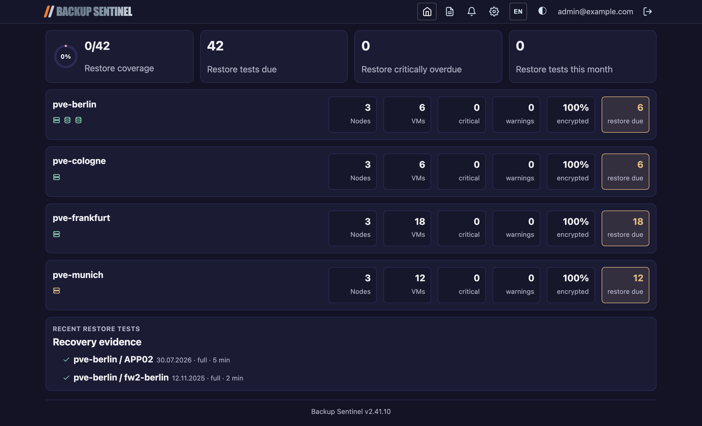

# Backup Sentinel -- Benutzerhandbuch

## Inhaltsverzeichnis

1. [Dashboard](#dashboard)
2. [Cluster-Detailseite](#cluster-detailseite)
3. [Berichte](#berichte)
4. [Einstellungen](#einstellungen)
5. [Design & Sprache](#design--sprache)

---

## Dashboard

Das Dashboard (`/`) bietet eine Gesamt-Übersicht über alle überwachten Proxmox-Cluster.

### Gesundheitsleiste (Health Bar)

Am oberen Seitenrand zeigt eine farbige Leiste jeden Cluster als Segment an:

| Farbe  | Bedeutung                                         |
|--------|---------------------------------------------------|
| Grün  | Alle Backups OK, keine Warnungen                  |
| Gelb   | Mindestens eine Warnung (z. B. veralteter Sync)   |
| Rot    | Kritische Probleme (fehlgeschlagene Backups, Sync-Fehler) |
| Grau   | Nie synchronisiert / unbekannter Status           |

Ein **stale**-Badge erscheint, wenn Syncs über längere Zeit fehlschlagen. Klicken Sie auf ein Segment, um zur Cluster-Detailseite zu gelangen.

### KPI-Karten

Unterhalb der Gesundheitsleiste werden vier Zusammenfassungskarten angezeigt:

- **Restore-Abdeckung** -- Ein Ringdiagramm mit dem Prozentsatz der VMs, die einen dokumentierten Restore-Test haben (z. B. 85 %). Die Farbe wechselt von Grün (>= 80 %) über Gelb (>= 50 %) zu Rot (< 50 %).
- **Restore überfällig** -- Anzahl der VMs, deren Restore-Test-Intervall abgelaufen ist.
- **Restore kritisch** -- Anzahl der VMs im kritischen Restore-Test-Status.
- **Diesen Monat getestet** -- Anzahl der im laufenden Kalendermonat dokumentierten Restore-Tests.

### Cluster-Karten

Jeder Cluster wird als Karte dargestellt mit:

- Clustername mit Gesamtstatus-Badge (OK / Warnung / Kritisch).
- Zeitstempel der letzten erfolgreichen PVE-Synchronisation.
- Fehler-seit-Zeitstempel, falls die letzte Synchronisation fehlschlug.
- Anzahl der Nodes, VMs und eine Aufschlüsselung der Backup-Status.
- PBS-Verbindungsstatus (sofern konfiguriert).
- Aktuelle Restore-Test-Ergebnisse als kompakte Icons.

Klicken Sie auf eine Cluster-Karte, um zur Detailseite zu navigieren.

---

## Cluster-Detailseite

Die Cluster-Detailseite (`/clusters/<slug>`) bietet einen detaillierten Einblick in einen einzelnen Proxmox-Cluster.

### Sync-Status

Im oberen Bereich zeigt die Hero-Sektion:

- **Sync-Button** -- Löst eine sofortige Neusynchronisation des Clusters aus.
- **PVE-Sync-Status** -- Ein farbiger Punkt (grün = Erfolg, rot = Fehler, grau = nie synchronisiert) mit dem letzten Sync-Zeitstempel. Klicken Sie auf den Punkt, um das vollständige Sync-Log anzuzeigen.
- **PBS-Sync-Status** -- Eine Zeile pro verbundenem PBS mit demselben Punkt + Zeitstempel-Muster.

### Statistik-Kacheln

Interaktive Statistik-Kacheln zeigen Node-Anzahl, VM-Anzahl, Kritisch/Warnung-Zähler, Verschlüsselungsgrad und Restore-fällig-Anzahl. Klicken Sie auf eine Kachel, um die VM-Tabelle darunter auf passende Zeilen zu filtern.

### Warnung bei unverschlüsselten Backups

Falls VMs unverschlüsselte Backups haben, listet ein aufklappbarer Warnbereich die betroffenen VMs mit dem Datum des letzten unverschlüsselten Backups auf.

### VM-Tabelle

Die Haupttabelle listet jede VM im Cluster mit sortierbaren Spalten:

| Spalte         | Beschreibung                                                |
|----------------|-------------------------------------------------------------|
| Node           | Der Proxmox-Node, auf dem die VM läuft                     |
| VM             | Gastname                                                    |
| VMID           | Proxmox-VM-ID                                               |
| Letztes Backup | Zeitstempel des jüngsten Backups; zeigt eine Fortschrittsanzeige bei laufendem Backup |
| 30 Tage        | Sparkline mit täglichem Backup-Status der letzten 30 Tage (grün = OK, rot = fehlgeschlagen, grau = kein Backup) |
| Backup         | Backup-Art (Snapshot/Stop/Suspend), Schweregrad-Badge, Quelle (Lokal/PBS) und Policy-Override-Dropdown |
| Restore-Test   | Letztes Restore-Test-Ergebnis (bestanden/eingeschränkt/fehlgeschlagen), Recovery-Typ-Icon, Datum und Dauer; dazu ein Fälligkeits-Badge (Warnung/Kritisch) |

**Node-Filterleiste** -- Buttons oberhalb der Tabelle filtern VMs nach Node.

**Sortierung** -- Klicken Sie auf einen Spaltenkopf, um auf-/absteigend zu sortieren.

**Backup-Policy-Override** -- Verwenden Sie das Dropdown in der Backup-Spalte, um die automatisch erkannte Policy für eine VM zu überschreiben (täglich / wöchentlich / nie / automatisch).

**Restore-Test-Fälligkeit** -- Das Badge in der Restore-Test-Spalte warnt rechtzeitig vor Ablauf des Test-Intervalls. Der Vorlauf richtet sich nach dem Intervall: bei **jährlichen** Intervallen erscheint die **Warnung 1 Monat** vorher, bei **quartalsweisen** (oder kürzeren) Intervallen **2 Wochen** vorher. Nach Ablauf des Intervalls wechselt der Status auf **Kritisch**. Fahren Sie mit der Maus über das Badge, um Intervall und Alter in Tagen zu sehen.

**Gelöschte VMs** -- VMs, die im Proxmox-Cluster nicht mehr existieren, erscheinen ausgegraut mit dem Badge **gelöscht** (Tooltip: seit wann), solange noch Backups von ihnen vorhanden sind. Sie lösen keine Backup- oder Restore-Warnungen aus. Sobald keine Backups mehr existieren, wird die VM beim nächsten Sync samt Restore-Test-Historie aus der Datenbank entfernt -- allerdings nur, wenn in diesem Sync alle PVE-Nodes, -Speicher und PBS-Datastores erreichbar waren.

**Mobile Ansicht** -- Auf schmalen Bildschirmen (Smartphone) wird die Tabelle automatisch in Karten umgewandelt: pro VM eine Karte mit beschrifteten Feldern, sodass nichts horizontal weggescrollt werden muss.

### Restore-Test-Formular

Unterhalb der VM-Tabelle kann ein neuer Restore-Test dokumentiert werden:

1. VM aus dem Dropdown auswählen.
2. Testdatum wählen.
3. Recovery-Typ auswählen: **Vollständig** (komplette VM-Wiederherstellung), **Teilweise** (partielle Daten) oder **Datei** (einzelne Datei-Recovery).
4. Ergebnis auswählen: **Bestanden**, **Eingeschränkt** (teilweise erfolgreich) oder **Fehlgeschlagen**.
5. Dauer in Minuten eingeben.
6. Optionale Notizen hinzufügen.
7. Absenden.

Der Restore-Test wird in der Datenbank gespeichert und sofort in der VM-Tabelle, den KPI-Karten und den Monatsberichten reflektiert.

### Restore-Test-Verlauf

Eine Tabelle unterhalb des Formulars zeigt die jüngsten Restore-Tests für diesen Cluster, einschließlich VM-Name, Datum, Typ, Ergebnis, Dauer und durchführender Person.

---

## Berichte

Die Berichtsseite (`/reports`) stellt monatliche Backup-Compliance-Berichte bereit.

### Aktuelle Berichtszusammenfassung

Eine Hero-Karte am oberen Rand zeigt aggregierte Statistiken für den aktuellen Berichtszeitraum:

- **Backups gesamt** -- Anzahl der Backup-Events.
- **OK** -- Erfolgreiche Backups.
- **Fehler** -- Fehlgeschlagene Backups.
- **Gelöscht** -- Backups, die vom Speicher entfernt wurden.
- **PDF-Snapshot**-Button -- Erzeugt auf Anforderung einen PDF-Bericht für den aktuellen Monat.

### Cluster-Aufschlüsselung

Unterhalb der Zusammenfassung wird jeder Cluster als aufklappbare Karte dargestellt. Beim Aufklappen werden die VM-Details sichtbar:

- Jede VM ist ein verschachtelter aufklappbarer Bereich.
- VMs mit Fehlern oder Löschungen sind standardmäßig aufgeklappt.
- Die innere Tabelle zeigt einzelne Backup-Events mit Datum, Größe, Verschlüsselungsstatus, Verifikationsstatus und Ergebnis.

### Berichtsarchiv

Am unteren Rand steht eine Liste zuvor erstellter Berichte (PDF und JSON) zum Download bereit. Berichte werden im `/reports`-Volume gespeichert und bleiben über Container-Neustarts hinweg erhalten.

Monatsberichte werden am Ende jedes Monats automatisch erstellt. Sie können jederzeit über den PDF-Snapshot-Button einen Bericht manuell auslösen.

---

## Einstellungen

Die Einstellungsseite (`/settings`) ist die zentrale Verwaltung für Cluster, PBS-Verbindungen und Benachrichtigungen.

### Neuen Cluster hinzufügen

1. **Clustername** eingeben (z. B. `pve-prod`).
2. **PVE-API-URL** eingeben (z. B. `https://pve.example.internal:8006`).
3. Auf **Cluster vorbereiten** klicken.
4. Ein Bootstrap-Skript wird angezeigt. Führen Sie dieses Skript auf einem beliebigen Node des Proxmox-Clusters aus, um einen API-Token zu erstellen und den Cluster automatisch zu registrieren.
5. Die Seite wartet auf den Abschluss -- sobald das Skript fertig ist, erscheint der Cluster in der Liste.

### Cluster verwalten

Jeder registrierte Cluster wird als Karte angezeigt mit:

- **Sync-Button** -- Löst eine sofortige Synchronisation aus.
- **Clustername-Link** -- Navigiert zur Cluster-Detailseite.
- **Umbenennen-Button** -- Ändert den Anzeigenamen.
- **Löschen-Button** -- Entfernt den Cluster und alle zugehörigen Daten.
- **PVE-URL** -- Der konfigurierte API-Endpunkt.
- **Letzte Sync** -- Zeitstempel der letzten erfolgreichen Synchronisation.

### PBS-Verbindungen

Jede Cluster-Karte hat einen "PBS hinzufügen"-Bereich, um einen Proxmox Backup Server anzubinden:

1. **PBS-Name** eingeben (Anzeige-Label).
2. **PBS-API-URL** eingeben.
3. Ein Bootstrap-Skript wird angezeigt, das auf dem PBS-Host ausgeführt werden muss.
4. Nach der Verbindung erscheint der PBS unter dem Cluster mit eigenem Sync-Status.

PBS-Verbindungen können einzeln entfernt werden.

### Benachrichtigungs-Einstellungen

Ein eigener Bereich konfiguriert die Benachrichtigungskanäle:

**Gotify (Push-Benachrichtigungen):**
- Gotify-Server-URL.
- API-Token (verschlüsselt gespeichert).
- Aktivieren/Deaktivieren-Schalter.
- Test-Button zur Verbindungsprüfung.

**E-Mail (SMTP):**
- SMTP-Host, Port, TLS-Modus (SSL/STARTTLS/ohne).
- Benutzername und Passwort (verschlüsselt gespeichert).
- Absenderadresse und Empfängerliste.
- Aktivieren/Deaktivieren-Schalter.
- Test-Button zum Senden einer Test-E-Mail.

**Ruhezeiten (Quiet Hours):**
- Ruhezeiten aktivieren/deaktivieren.
- Start- und Endzeit (z. B. 22:00 -- 07:00).
- Während der Ruhezeiten werden Benachrichtigungen unterdrückt.

### Governance-Panel

Ein Seitenbereich fasst die NIST-CSF-2.0-Ausrichtung zusammen:

- **Identify** -- Asset-Inventar über PVE/PBS-Sync.
- **Protect** -- Verschlüsselungs-Monitoring, Backup-Policy-Durchsetzung.
- **Detect** -- Automatische Alarmierung bei Fehlern und Anomalien.
- **Recover** -- Dokumentierte Restore-Tests mit Compliance-Tracking.

### Einstellungs-Auditlog

Änderungen an Einstellungen werden mit Zeitstempel und dem ändernden Benutzer protokolliert (abgeleitet aus den OAuth2-Proxy-Headern).

---

## Design & Sprache

### Design umschalten

Backup Sentinel unterstützt drei Design-Modi, erreichbar über die Kopfzeile:

- **Hell** -- Heller Hintergrund mit dunklem Text.
- **Dunkel** -- Dunkler Hintergrund mit hellem Text.
- **Automatisch** -- Folgt der Betriebssystem-Einstellung (`prefers-color-scheme`).

Die Auswahl wird in einem Browser-Cookie gespeichert und bleibt sitzungsübergreifend erhalten.

### Sprache umschalten

Die Anwendung ist vollständig zweisprachig (Deutsch und Englisch). Wechseln Sie die Sprache über das Kopfzeilen-Menu. Die Auswahl wird im Cookie `bsentinel-lang` gespeichert.

Alle UI-Beschriftungen, Benachrichtigungen und generierten Berichte berücksichtigen die gewählte Sprache.
